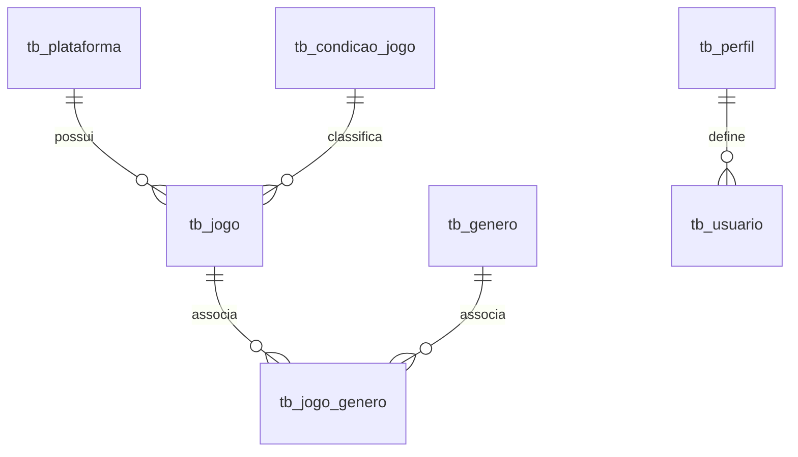

# Modelo entidade-relacionamento

A chave de tb_jogo_genero é (co_jogo, co_genero). O mínimo de um gênero por jogo é uma regra do Service, não uma restrição estrutural do banco. As chaves estrangeiras impedem referências inexistentes; não removem dependentes automaticamente. O SQL completo e o dicionário efetivamente adotado estão em database/001_estrutura.sql.
